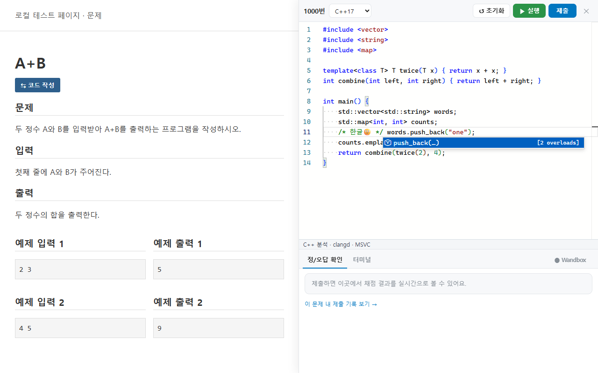

# Convenient_BOJ · Windows C++ 워크스페이스

**원작은 gaudium1257님의 Convenient_BOJ입니다.** 백준 문제 옆에서 코드를 작성하고 예제를 실행한 뒤, 공식 제출 페이지를 열고 채점 결과를 확인하는 크롬 확장입니다. kusonnim은 원작자의 허락을 받아 이 포크를 관리합니다. [원본 저장소](https://github.com/gaudium1257/Convenient_BOJ)

이 포크의 기본 브랜치 `workspace`는 원작 v1.3.3에서 출발했습니다. `main`에는 포크 시점의 원작 v1.4.0이 있습니다. 아래 기능과 설치 방법은 `workspace` 기준입니다. [원작 v1.3.3](https://github.com/gaudium1257/Convenient_BOJ/tree/v1.3.3) · [이 포크 설치](#설치)

| 구분 | 사용할 수 있는 기능 |
| --- | --- |
| 원작 v1.3.3 | 문제·에디터 분할 화면, 문제·언어별 초안과 기본 코드, C/C++/Python 예제 비교, 로컬 도우미와 Wandbox 실행, 공식 제출 탭 채우기와 채점 결과 표시 |
| 포크 · Windows MSVC | 설치된 x64 MSVC로 C++17/20을 컴파일합니다. 로컬 컴파일러와 백준 제출 언어를 따로 선택할 수 있습니다. |
| 포크 · 실행 안정성 | 같은 연결에서 유효한 빌드를 재사용하고 예제마다 새 프로세스를 실행합니다. 중지·시간 초과·연결 종료 시 자식 프로세스를 정리합니다. 로컬 실행이 불가능하면 Wandbox로 소스와 입력을 보내기 전에 선택을 받습니다. |
| 포크 · Monaco 편집기 | 확장에 포함된 Monaco에서 다중 커서, 열 선택, 접기, 찾기·바꾸기를 사용합니다. 기존 초안과 커서 위치를 이어서 엽니다. |
| 포크 · clangd IntelliSense | 로컬 clangd와 C++ 헤더로 멤버·헤더 완성, 함수 매개변수 안내, 호버, 정의로 이동, 실시간 진단을 제공합니다. |

로컬 테스트 페이지에서 `std::vector`의 `push_back` 오버로드 두 개를 제안하는 실제 P3 화면입니다.



## 기능

### ⇆ 분할 화면 (문제 | 코드)
- 문제 페이지(`/problem/번호`)에서 제목 옆 **[⇆ 코드 작성]** 버튼이나 **Alt + C**로 엽니다.
- 왼쪽에는 원래 문제가 그대로 있고, 오른쪽에 코드 에디터와 결과 창이 붙습니다.
- 패널 왼쪽 경계와 에디터·결과 사이 경계를 끌어서 크기를 바꿀 수 있어요(크기는 기억돼요).
- 작성한 코드는 **문제·언어별로 자동 저장**돼서 다시 열어도 그대로 있어요.
- 코드 작성에는 VS Code의 **Monaco Editor**를 사용해요. 선택한 텍스트를 끌어서 옮기거나, Alt+클릭으로 여러 곳을 동시에 편집할 수 있어요. Shift+Alt를 누르고 끌면 열을 선택해요. 미니맵은 팝업에서 켤 수 있어요.
- **들여쓰기**는 팝업에서 고를 수 있어요.
  - **탭**(기본): Tab 키가 탭 문자 하나를 넣고, Backspace 한 번에 지워져요. 들여쓰기의 탭은 화살표로, 공백은 점으로 보여요.
  - **공백 4칸**: Tab 키가 공백을 4칸 단위로 넣고, 줄 앞 공백은 Backspace 한 번에 4칸씩 지워져요.
- **엔터 자동 들여쓰기는 VS Code 규칙**을 따라요.
  - C/C++: 닫히지 않은 `{` 또는 `(`로 끝나는 줄 다음만 한 단계 들여쓰기 (`;`가 빠진 줄, `if (x)` 다음은 같은 깊이)
  - Python: `def`/`if`/`for`/`while`/`else`… 로 시작해 `:`로 끝나는 줄, 열린 괄호로 끝나는 줄 다음은 들여쓰기, `return`/`pass`/`break`/`continue`/`raise` 다음은 내어쓰기
  - 괄호 쌍 사이(`{|}`, `(|)`, `[|]`)에서 엔터를 누르면 가운데 줄을 만들고 닫는 괄호는 원래 깊이로
- 새 문제를 열 때 들어가는 **기본 코드는 팝업에서 언어별로 바꿀 수 있어요.** `$0` 자리에 커서가 놓여요.
  다시 열면 마지막으로 작업하던 위치로 돌아가요.
  - C++: 백준 권장 빠른 입출력(`ios::sync_with_stdio(false); cin.tie(nullptr);`)이 들어간 형태
  - C: `stdio.h` + `main` 뼈대
  - Python: 빈 코드 (빠른 입력이 필요하면 `import sys` / `input = sys.stdin.readline` 을 추가해 두세요)

[원작의 코드 작성 버튼](docs/screenshots/01-toggle-button.jpg) · [원작 v1.3.3 분할 화면](docs/screenshots/02-split-view.jpg)

### C++ 코드 분석

C++ 초안을 열면 도우미가 설치된 clangd와 호환되는 표준 라이브러리 헤더를 찾습니다. 편집기 아래에서 분석에 사용하는 헤더 환경을 확인할 수 있어요. Ctrl+Space로 완성을 열고 F12로 선언을 찾아가세요. 표준 라이브러리의 선언은 읽기 전용으로 열립니다. clangd의 밑줄은 편집 중 진단이고, 실행할 때의 컴파일 결과는 터미널에 표시돼요. clangd가 없어도 기본 편집과 설치된 컴파일러를 이용한 실행은 사용할 수 있어요. [진단 화면](docs/development/evidence/p3/diagnostic-dark.png) · [함수 매개변수 안내](docs/development/evidence/p3/signature-help.png)

### ▶ 실행: C / C++ / Python
- **실행**(Ctrl + Enter)을 누르면 결과 창이 **터미널**로 바뀌고, 문제의 **예제 입력으로 코드를 돌려 예제 출력과 비교**해요.
  - 틀린 예제는 입력 / 기대 출력 / 내 출력을 나란히 보여 줘요.
  - 컴파일 에러, 런타임 에러, stderr도 그대로 보여 줘요.
- 터미널 아래 칸에서 **직접 실행**할 수 있어요.
  - [내 PC 실행 도우미](#2단계-내-pc에서-실행-진짜-터미널-선택)를 설치했다면 **VS Code 터미널처럼** 동작해요. 프로그램이 실행 중일 때 입력하고 Enter를 치면 바로 전달돼요. Ctrl+C로 중지, Ctrl+D로 입력 끝.
  - 로컬 도구가 없으면 코드와 입력을 Wandbox에 보낼지 실행할 때 물어봐요. 동의하면 결과를 한꺼번에 보여 줘요.
- 터미널 탭 오른쪽 위에 지금 **실행 위치**(● 내 PC / ● Wandbox)가 보여요.
- 언어 목록은 백준의 언어 설정에서 고른 언어를 따라요. C(C99/C11/…), C++(C++14/17/20/…, Clang 포함), Python 3 / PyPy3 를 지원해요.
- 팝업의 **실행 환경**에서 MSVC, GCC 또는 Wandbox를 고를 수 있어요. 자동 모드는 C++17/20에 설치된 x64 MSVC를 우선하고, 다른 C++ 표준에는 가능한 경우 GCC를 사용해요. 백준 제출 언어는 따로 유지돼요.
- MSVC는 `/O2 /EHsc /utf-8`, 선택한 `/std:c++17` 또는 `/std:c++20`과 `ONLINE_JUDGE`, `BOJ` 매크로를 사용해요. GCC는 `-O2 -std=<언어 버전> -DONLINE_JUDGE -DBOJ`를 쓰고 C에는 `-lm`을 추가해요.
- MSVC의 새 C++ 코드는 `<iostream>`으로 시작해요. GNU 전용 `bits/stdc++.h`, `__int128` 등이 필요한 코드는 GCC로 실행할 수 있어요. 대화형 출력은 필요할 때 `std::flush`나 `std::endl`로 비워 주세요.
- 같은 탭에서 소스, 컴파일 설정과 헤더가 같으면 빌드 결과를 재사용해요. 예제 실행 중 **■ 중지**를 누르면 컴파일이나 실행을 취소할 수 있어요.

아래 P2 화면에서는 어두운 Monaco 편집기에서 작성한 코드를 로컬 MSVC로 실행했어요. 터미널에 빌드 캐시 재사용과 예제 두 개의 통과 결과가 보입니다.


원작의 실행 화면도 참고할 수 있어요. [예제 통과](docs/screenshots/03-run-pass.jpg) · [예제 불일치](docs/screenshots/04-run-wrong.jpg) · [컴파일 오류](docs/screenshots/05-compile-error-dark.jpg)

### 제출 → 정/오답 확인
1. 분할 화면(A)에서 **제출**(Ctrl + Shift + Enter)을 누르면 같은 창의 바로 옆에 백준 제출 탭(B)이 열리고, **작성한 코드와 언어가 채워져 있어요.**
2. B에서 백준의 **[제출]** 버튼만 누르면 돼요.
   백준 제출에는 보안 확인(reCAPTCHA)이 있어서, 마지막 버튼은 사람이 직접 눌러야 해요.
3. 제출하자마자 **포커스가 A로 돌아와요.** B는 뒤에서 채점 현황을 지켜보고,
   A의 **정/오답 확인** 탭에 `채점 중 → 맞았습니다!!` 가 실시간으로 표시돼요.
4. 채점이 끝나면 **B는 자동으로 닫혀요.** 채점 전에 B를 직접 닫으면 A에 "제출 기록 열기" 안내가 떠요.

| 원작의 제출 탭 | 원작의 채점 결과 화면 |
| --- | --- |
|  |  |

- 메모리·시간·코드 보기 링크와 **이 문제 내 제출 기록** 링크를 함께 보여 줘요.
- 코드 공개 설정은 팝업에서 고를 수 있어요(기본값: 백준 설정을 따름).
- 현재는 한 번에 한 문제의 제출 탭을 사용하세요. 두 번째 제출 탭을 열면 먼저 연 탭이 닫힐 수 있어요. 이 동작은 로컬 테스트에서 확인했고 P4에서 수정할 예정입니다. [검증 기록](docs/development/P3.md)

## 설치

### 1단계: 확장 프로그램 (필수)

1. 이 포크의 **workspace 소스 ZIP**을 내려받아 압축을 풉니다. Monaco와 워커가 포함되어 있어 별도 빌드가 필요 없어요. [workspace ZIP 다운로드](https://github.com/kusonnim/Convenient_BOJ-Workspace/archive/refs/heads/workspace.zip)
2. 크롬 주소창에 `chrome://extensions` 를 입력합니다.
3. 오른쪽 위 **개발자 모드**를 켭니다.
4. **압축해제된 확장 프로그램을 로드합니다**를 누르고, 압축을 푼 폴더 중 `manifest.json`과 `host`가 바로 보이는 `Convenient_BOJ-Workspace-workspace` 폴더를 고릅니다.
5. 백준 문제 페이지를 새로고침하면 끝!

> 압축을 푼 폴더는 지우지 마세요. 크롬이 그 폴더에서 확장을 읽어요.

도우미 없이 온라인으로 실행하려면 Wandbox 전송 안내에서 동의하거나 팝업에서 Wandbox를 선택해요.

gaudium1257님의 원작 배포판은 별도로 받을 수 있어요. [원작 Releases](https://github.com/gaudium1257/Convenient_BOJ/releases/latest)

### 2단계: 내 PC에서 실행 (진짜 터미널, 선택)

코드를 내 PC에서 컴파일·실행하고, VS Code처럼 실행 중에 입력을 주고받는 **진짜 터미널**을 쓰려면 (Windows):

1. 압축을 푼 폴더의 **`host\install.bat`** 을 더블클릭해요.
2. 묻는 대로 답해요. (모두 Enter = 예)
   - Python이 없으면 설치할지 물어봐요. (도우미가 Python으로 동작해요)
   - 설치된 Visual Studio 또는 Build Tools의 x64 C++ 도구와 Windows SDK를 자동으로 찾아요. MSVC와 g++를 찾지 못하면 WinLibs 설치 여부를 물어봐요. Python만 쓰면 건너뛰어도 돼요.
3. 백준 문제 탭을 새로고침하면 터미널 탭 오른쪽 위가 **● 내 PC** 로 바뀌어요.

- 관리자 권한은 필요 없어요. 도우미는 `%LOCALAPPDATA%\ConvenientBOJ` 에 설치되고 크롬·엣지·웨일에 등록돼요.
- 지우려면 `host\uninstall.bat` 을 실행해요. (Python·gcc는 지우지 않아요)
- 이전 도우미에서 MSVC를 사용하려면 새 폴더의 `host\install.bat`을 다시 실행하고 문제 탭을 새로고침해요. 기존 도구로 Chrome에만 등록할 때는 PowerShell에서 `.\host\install.ps1 -RegisterOnly -ChromeOnly`를 실행해요.
- C++ IntelliSense에는 도우미, 로컬 clangd와 호환되는 C++ 헤더가 필요해요. 이미 설치된 Visual Studio C++ 도구와 Windows SDK 또는 GCC 헤더를 사용할 수 있어요. clangd가 없다면 설치 후 편집기를 다시 여세요. [clangd 공식 설치 안내](https://clangd.llvm.org/installation)

### 업데이트
같은 `workspace` ZIP에서 받은 확장 파일을 기존 설치 폴더에 반영한 뒤 `chrome://extensions`에서 Convenient BOJ의 새로고침(↻)을 누르고 문제 탭도 새로고침해 주세요. 도우미가 바뀌었으면 새 설치 폴더의 `host\install.bat`도 다시 실행해 주세요.

개발 기록과 다음 단계의 계획은 로드맵에서 볼 수 있어요. [단계별 로드맵](ROADMAP.md)

## 단축키

| 키 | 동작 |
| --- | --- |
| Alt + C | 분할 화면 열기/닫기 |
| Ctrl + Enter | 예제로 실행 |
| Ctrl + Shift + Enter | 제출 탭 열기 |
| Ctrl + S | 코드 저장 |
| Ctrl + Space | 완성 목록 열기 (C++ 분석이 연결되면 clangd 제안 표시) |
| F12 | C++ 분석이 연결된 편집기에서 선언으로 이동 |
| Ctrl + F | 편집기 안에서 찾기 (왼쪽 화살표로 바꾸기 열기) |
| Alt + ↑ / ↓ | 줄 이동 |
| Shift + Alt + ↑ / ↓ | 줄 복제 |

## 알아 두면 좋은 점

- **코드 실행 위치:** 내 PC 도우미는 현재 사용자의 권한으로 코드를 실행해요. Wandbox를 선택하면 코드와 입력이 그 서버로 보내져요. 로컬 실행 시간은 백준 채점 시간과 다를 수 있어요.
- 1.3.0부터 확장 프로그램 ID를 고정했어요(도우미가 이 확장의 요청만 받도록). 그 전 버전을 쓰던 경우, 처음 한 번은 저장된 코드·설정이 초기화될 수 있어요.
- **제출은 백준의 진짜 제출 페이지에서 해요.** 확장은 코드를 채워 주고 결과를 읽어 올 뿐, 비밀번호나 로그인 정보를 따로 다루지 않아요.
  백준은 스크립트로 보내는 요청에 빈 응답을 주기 때문에, 확장이 몰래 대신 제출하는 방식은 쓰지 않아요.
- 초안은 Chrome의 로컬 저장소에 저장돼요. 테마와 기본 코드 등 동기화 대상 설정은 Chrome 동기화 설정을 따라요. C++ 분석을 쓸 때는 열린 초안을 PC의 도우미를 통해 로컬 clangd에 전달해요.

## 구조

```
manifest.json            확장 설정 (MV3)
background.js            코드 실행(Wandbox API), 내 PC 도우미 연결, 제출 탭 열기·포커스·닫기
content/split.js         분할 화면: 에디터, 실행 터미널, 제출 탭 열기, 채점 결과 표시
content/split.css
content/editor.js        초안·커서와 편집기 프레임 연결
editor/                  확장 전용 Monaco 편집 화면
content/submit.js        제출 페이지: 코드·언어 채우기 안내, 언어 목록 저장
content/submit-main.js   제출 페이지(페이지 world): 백준 에디터에 코드 넣기
content/status.js        채점 현황 페이지: A로 포커스 돌리기, 결과를 분할 화면으로 전달
popup/                   설정 팝업
host/                    내 PC 실행 도우미(cboj_host.py)와 설치·제거 스크립트
shared/defaults.js       공통 기본 설정
shared/boj.js            채점 결과 읽기
vendor/monaco/           Monaco Editor·워커·글꼴·라이선스
tools/monaco/            고정 버전 편집기 빌드 (npm ci, npm run build)
docs/screenshots/        원작 화면 캡처
docs/development/evidence/   P0–P3 검증 화면과 결과
.github/workflows/       태그를 올리면 Releases에 ZIP 배포
```
