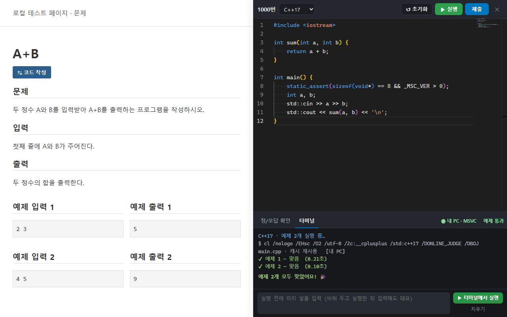

# Convenient_BOJ · Windows C++ 워크스페이스

**원작은 gaudium1257님의 Convenient_BOJ입니다.** 원작은 백준 문제와 편집기를 나란히 띄우고 문제·언어별 초안을 저장합니다. C/C++/Python 예제 실행, 대화형 터미널, 공식 제출 탭 채우기와 채점 결과 표시도 원작의 기능입니다. kusonnim은 원작자의 허락을 받아 이 GitHub 포크를 관리합니다. [원본 저장소](https://github.com/gaudium1257/Convenient_BOJ)

**포크를 설치하려면 `workspace` 브랜치의 소스 ZIP을 받으세요.** 압축을 풀고 `chrome://extensions`에서 개발자 모드를 켠 뒤, **압축해제된 확장 프로그램을 로드합니다**를 눌러 `manifest.json`이 들어 있는 폴더를 선택하세요. Git으로 받을 때는 `git clone --branch workspace https://github.com/kusonnim/Convenient_BOJ-Workspace.git`을 사용하세요. [workspace ZIP 다운로드](https://github.com/kusonnim/Convenient_BOJ-Workspace/archive/refs/heads/workspace.zip) · [Windows 도우미와 clangd 설치 안내](https://github.com/kusonnim/Convenient_BOJ-Workspace/blob/workspace/README.md#설치)

| 포크에서 추가한 기능 | 동작 |
| --- | --- |
| Windows MSVC | 설치된 x64 MSVC로 C++17/20을 컴파일합니다. 로컬 컴파일러와 백준 제출 언어를 따로 고를 수 있습니다. |
| 실행 안정성 | 같은 연결에서 유효한 빌드를 재사용하고 예제마다 새 프로세스를 실행합니다. 중지·시간 초과·연결 종료 시 자식 프로세스를 정리하며 Wandbox 전송에는 사용자의 선택이 필요합니다. |
| Monaco 편집기 | 확장에 포함된 Monaco에서 다중 커서, 열 선택, 찾기·바꾸기와 접기를 사용합니다. 기존 초안과 커서 위치를 이어서 엽니다. |
| clangd IntelliSense | 로컬 C++ 헤더로 멤버·헤더 완성, 함수 매개변수 안내, 호버, 선언으로 이동과 실시간 진단을 제공합니다. |

| P2 · Monaco에서 로컬 MSVC 빌드를 재사용해 예제 두 개 통과 | P3 · 로컬 clangd가 제안한 `push_back` 오버로드 두 개 |
| --- | --- |
|  |  |

기본 브랜치 `main`에서는 원작 v1.4.0 코드를 볼 수 있습니다. 이 포크의 개발 브랜치 `workspace`는 원작 v1.3.3을 바탕으로 위 기능을 추가했습니다. 현재 제출 탭을 두 개 열면 첫 탭이 닫힐 수 있어 한 번에 한 문제의 제출 탭을 사용하세요. [워크스페이스 코드](https://github.com/kusonnim/Convenient_BOJ-Workspace/tree/workspace) · [개발 로드맵](ROADMAP.md) · [P3.5 이관 기록](https://github.com/kusonnim/Convenient_BOJ-Workspace/blob/workspace/docs/development/P3.5.md)

<details>
<summary>원작 v1.4.0 사용 설명과 원작 배포판 설치 방법</summary>

백준(acmicpc.net) 문제 화면에서 **문제 읽기 → 코드 작성 → 실행 → 제출 → 정/오답 확인**을 한 화면에서 끝낼 수 있게 해 주는 크롬 확장 프로그램입니다.

```
┌──────────────┬──────────────────────────┐
│              │  코드 작성   [▶ 실행][제출] │
│     문제      ├──────────────────────────┤
│              │  정/오답 확인 | 터미널      │
└──────────────┴──────────────────────────┘
```


## 기능

### ⇆ 분할 화면 (문제 | 코드)
- 문제 페이지(`/problem/번호`)에서 제목 옆 **[⇆ 코드 작성]** 버튼이나 **Alt + C**로 엽니다.
- 왼쪽에는 원래 문제가 그대로 있고, 오른쪽에 코드 에디터와 결과 창이 붙습니다.
- 패널 왼쪽 경계와 에디터·결과 사이 경계를 끌어서 크기를 바꿀 수 있어요(크기는 기억돼요).
- 작성한 코드는 **문제·언어별로 자동 저장**돼서 다시 열어도 그대로 있어요.
- **들여쓰기**는 팝업에서 고를 수 있어요.
  - **탭**(기본): Tab 키가 탭 문자 하나를 넣고, Backspace 한 번에 지워져요. 탭은 옅은 세로선으로 보여서 공백과 구분돼요.
  - **공백 4칸**: Tab 키가 공백을 4칸 단위로 넣고, 줄 앞 공백은 Backspace 한 번에 4칸씩 지워져요.
- **엔터 자동 들여쓰기는 VS Code 규칙**을 따라요.
  - C/C++: 닫히지 않은 `{` 또는 `(`로 끝나는 줄, `case 1:`·`default:` 다음은 한 단계 들여쓰기 (`;`가 빠진 줄, `if (x)` 다음은 같은 깊이)
  - Python: `def`/`if`/`for`/`while`/`else`… 로 시작해 `:`로 끝나는 줄, 열린 괄호로 끝나는 줄 다음은 들여쓰기, `return`/`pass`/`break`/`continue`/`raise` 다음은 내어쓰기
  - 괄호 쌍 사이(`{|}`, `(|)`, `[|]`)에서 엔터를 누르면 가운데 줄을 만들고 닫는 괄호는 원래 깊이로
- 새 문제를 열 때 들어가는 **기본 코드는 팝업에서 언어별로 바꿀 수 있어요.** `$0` 자리에 커서가 놓여요.
  다시 열면 마지막으로 작업하던 위치로 돌아가요.
  - C++: 백준 권장 빠른 입출력(`ios::sync_with_stdio(false); cin.tie(nullptr);`)이 들어간 형태
  - C: `stdio.h` + `main` 뼈대
  - Java: 백준 규칙(`public class Main`) + `BufferedReader` 빠른 입력
  - Python: 빈 코드 (빠른 입력이 필요하면 `import sys` / `input = sys.stdin.readline` 을 추가해 두세요)
- **자동완성**: 입력하면서 키워드·변수 이름 후보를 띄워요. Ctrl+Space로 언제든 열 수 있고, 팝업에서 끌 수 있어요.
- **풀이 타이머**: 툴바의 ⏱ 를 누르면 시작/일시정지, ↺ 로 초기화. **맞았습니다!!** 를 받으면 멈추고 풀이 시간을 결과에 같이 보여 줘요. 팝업에서 자동 시작을 켤 수 있어요.


### ▶ 실행: C / C++ / Java / Python
- **실행**(Ctrl + Enter)을 누르면 결과 창이 **터미널**로 바뀌고, 문제의 **예제 + 나만의 테스트케이스**로 코드를 돌려 기대 출력과 비교해요.
  - 틀리면 **몇 번째 줄부터 다른지**, 줄 수가 모자란지·남는지, 공백만 다른지를 알려 주고 다른 줄을 강조해서 보여 줘요.
  - 컴파일 에러, 런타임 에러, 시간 초과, stderr도 그대로 보여 줘요.
- **나만의 테스트케이스**: **테스트케이스** 탭에서 문제마다 입력·기대 출력을 여러 개 저장해 두면 실행할 때마다 예제와 함께 채점돼요. 기대 출력을 비워 두면 출력만 보여 줘요. 터미널 입력 칸의 **케이스로 저장**으로도 추가할 수 있어요.
- 터미널 아래 칸에서 **직접 실행**할 수 있어요.
  - [내 PC 실행 도우미](#2단계-내-pc에서-실행-진짜-터미널-선택)를 설치했다면 **VS Code 터미널처럼** 동작해요. 프로그램이 실행 중일 때 입력하고 Enter를 치면 바로 전달돼요. Ctrl+C로 중지, Ctrl+D로 입력 끝.
  - 설치하지 않았다면 입력을 미리 적고 **이 입력으로 실행**을 누르면, 끝난 뒤 결과를 한꺼번에 보여 줘요(Wandbox).
- 터미널 탭 오른쪽 위에 지금 **실행 위치**(● 내 PC / ● Wandbox)가 보여요.
- 언어 목록은 백준 [언어 설정]에서 고른 언어를 따라요. C(C99/C11/…), C++(C++14/17/20/…, Clang 포함), Java(8/11/…), Python 3 / PyPy3 를 지원해요.
- 컴파일·실행 옵션은 백준과 맞췄어요: C/C++ `-O2 -std=<버전> -DONLINE_JUDGE` (C는 `-lm`), Java `-Xss512m -DONLINE_JUDGE=1`
  - 내 PC 실행 때 윈도우 기본 스택(1MB)은 백준보다 훨씬 작아서, C/C++은 스택을 256MB로 키워 깊은 재귀도 백준처럼 돌아가게 했어요.
- Wandbox(온라인)가 바쁘거나 잠깐 끊기면 자동으로 두 번까지 다시 시도해요.

| 예제 통과 | 예제 틀림 | 컴파일 에러 (어두운 테마) |
| --- | --- | --- |
|  |  |  |

### 제출 → 정/오답 확인
1. 분할 화면(A)에서 **제출**(Ctrl + Shift + Enter)을 누르면 같은 창의 바로 옆에 백준 제출 탭(B)이 열리고, **작성한 코드와 언어가 채워져 있어요.**
2. B에서 백준의 **[제출]** 버튼만 누르면 돼요.
   백준 제출에는 보안 확인(reCAPTCHA)이 있어서, 마지막 버튼은 사람이 직접 눌러야 해요.
3. 제출하자마자 **포커스가 A로 돌아와요.** B는 뒤에서 채점 현황을 지켜보고,
   A의 **정/오답 확인** 탭에 `채점 중 → 맞았습니다!!` 가 실시간으로 표시돼요.
4. 채점이 끝나면 **B는 자동으로 닫혀요.** 채점 전에 B를 직접 닫으면 A에 "제출 기록 열기" 안내가 떠요.

| 채워진 제출 탭 | 분할 화면에 뜬 결과 |
| --- | --- |
|  |  |

- 메모리·시간·코드 보기 링크와 **이 문제 내 제출 기록** 링크를 함께 보여 줘요.
- 코드 공개 설정은 팝업에서 고를 수 있어요(기본값: 백준 설정을 따름).

## 설치

### 1단계: 확장 프로그램 (필수)

1. [Releases](https://github.com/gaudium1257/Convenient_BOJ/releases/latest)에서 **Convenient_BOJ.zip** 을 내려받아 압축을 풉니다.
2. 크롬 주소창에 `chrome://extensions` 를 입력합니다.
3. 오른쪽 위 **개발자 모드**를 켭니다.
4. **압축해제된 확장 프로그램을 로드합니다** → 압축을 푼 `Convenient_BOJ` 폴더를 고릅니다.
5. 백준 문제 페이지를 새로고침하면 끝!

> 압축을 푼 폴더는 지우지 마세요. 크롬이 그 폴더에서 확장을 읽어요.

여기까지만 해도 모든 기능을 쓸 수 있어요. 코드 실행은 온라인 컴파일러(Wandbox)에서 해요.

### 2단계: 내 PC에서 실행 (진짜 터미널, 선택)

코드를 내 PC에서 컴파일·실행하고, VS Code처럼 실행 중에 입력을 주고받는 **진짜 터미널**을 쓰려면 (Windows):

1. 압축을 푼 폴더의 **`host\install.bat`** 을 더블클릭해요.
2. 묻는 대로 답해요. (모두 Enter = 예)
   - Python이 없으면 설치할지 물어봐요. (도우미가 Python으로 동작해요)
   - C/C++ 컴파일러(gcc/g++)가 없으면 WinLibs를 설치할지 물어봐요. (약 250MB, 안 쓰는 언어면 건너뛰어도 돼요)
   - Java(JDK)가 없으면 Temurin JDK 21을 설치할지 물어봐요. (약 200MB)
3. 백준 문제 탭을 새로고침하면 터미널 탭 오른쪽 위가 **● 내 PC** 로 바뀌어요.

- 관리자 권한은 필요 없어요. 도우미는 `%LOCALAPPDATA%\ConvenientBOJ` 에 설치되고 크롬·엣지·웨일에 등록돼요.
- 지우려면 `host\uninstall.bat` 을 실행해요. (Python·gcc는 지우지 않아요)
- 도우미를 설치하지 않은 PC에서는 지금처럼 Wandbox로 실행돼요.

### 업데이트
새 ZIP을 받아 같은 폴더에 덮어쓴 뒤, `chrome://extensions` 에서 Convenient BOJ의 새로고침(↻)을 누르고 백준 탭도 새로고침해 주세요.

### 새 버전 배포하기 (개발자용)
`manifest.json` 의 `version` 을 올리고 같은 번호로 태그를 올리면, GitHub Actions가 ZIP을 만들어 Releases에 올려요.

```powershell
git tag v1.0.1; git push origin v1.0.1
```

릴리스에는 ZIP이 두 개 올라가요.
- `Convenient_BOJ.zip`: 직접 설치용 (확장 ID를 고정하는 `key`와 도우미 포함)
- `Convenient_BOJ-webstore.zip`: 크롬 웹 스토어 업로드용 (스토어가 받지 않는 `key`와 도우미 파일을 뺌)

웹 스토어에 등록하면 스토어가 새 확장 ID를 줘요. 그 ID를 `host/install.ps1` 의 `$ExtensionIds` 에 추가해야 스토어 버전에서도 내 PC 실행 도우미가 연결돼요.

## 단축키

| 키 | 동작 |
| --- | --- |
| Alt + C | 분할 화면 열기/닫기 |
| Ctrl + Enter | 예제로 실행 |
| Ctrl + Shift + Enter | 제출 탭 열기 |
| Ctrl + S | 코드 저장 |
| Ctrl + Space | 자동완성 열기 |

## 알아 두면 좋은 점

- **코드 실행 위치:** 내 PC 실행 도우미를 설치했다면 내 PC에서, 아니면 [Wandbox](https://wandbox.org)(공개 온라인 컴파일러)에서 실행돼요. Wandbox를 쓸 때는 코드와 입력이 그 서버로 보내져요. 어느 쪽이든 백준 채점 서버와 환경이 달라서 실행 시간은 참고만 해 주세요.
- 1.3.0부터 확장 프로그램 ID를 고정했어요(도우미가 이 확장의 요청만 받도록). 그 전 버전을 쓰던 경우, 처음 한 번은 저장된 코드·설정이 초기화될 수 있어요.
- **제출은 백준의 진짜 제출 페이지에서 해요.** 확장은 코드를 채워 주고 결과를 읽어 올 뿐, 비밀번호나 로그인 정보를 따로 다루지 않아요.
  백준은 스크립트로 보내는 요청에 빈 응답을 주기 때문에, 확장이 몰래 대신 제출하는 방식은 쓰지 않아요.
- 작성 중인 코드와 설정은 브라우저(`chrome.storage`) 안에만 저장돼요.

## 구조

```
manifest.json            확장 설정 (MV3)
background.js            코드 실행(Wandbox API), 내 PC 도우미 연결, 제출 탭 열기·포커스·닫기
content/split.js         분할 화면: 에디터, 실행 터미널, 제출 탭 열기, 채점 결과 표시
content/split.css
content/submit.js        제출 페이지: 코드·언어 채우기 안내, 언어 목록 저장
content/submit-main.js   제출 페이지(페이지 world): 백준 에디터에 코드 넣기
content/status.js        채점 현황 페이지: A로 포커스 돌리기, 결과를 분할 화면으로 전달
popup/                   설정 팝업
host/                    내 PC 실행 도우미(cboj_host.py)와 설치·제거 스크립트
shared/defaults.js       공통 기본 설정
shared/boj.js            채점 결과 읽기
vendor/codemirror/       CodeMirror 5 (MIT)
docs/screenshots/        실제 동작 캡처
.github/workflows/       태그를 올리면 Releases에 ZIP 배포
```

</details>
