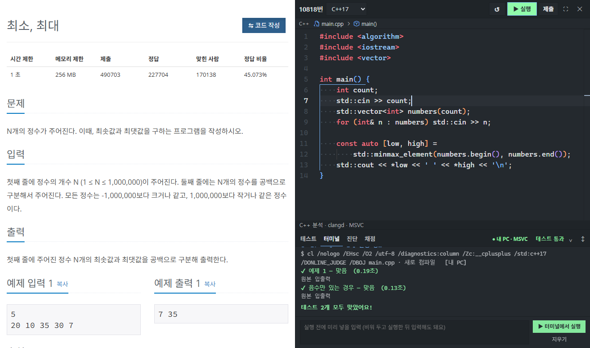
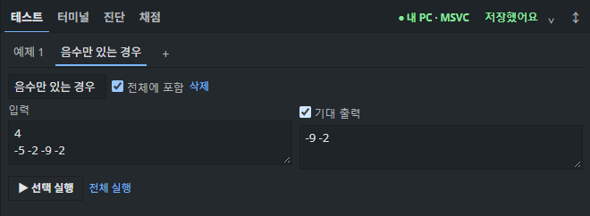
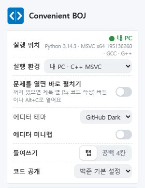

# Convenient_BOJ · 편한 백준

백준 문제 옆에 편집기를 열어 코드를 작성하고 예제를 실행하는 Chrome 확장 프로그램입니다. 채점 결과도 같은 화면에서 확인할 수 있습니다. **원작자는 gaudium1257님**이며, kusonnim은 원작자의 허락을 받아 이 포크에 Windows용 C++ 개발 도구를 추가했습니다. [원작 저장소](https://github.com/gaudium1257/Convenient_BOJ) · [포크 저장소](https://github.com/kusonnim/Convenient_BOJ-Workspace) · [설치 방법](#installation)

*백준 10818번 「최소, 최대」의 공식 예제와 음수만 넣은 테스트를 내 PC에서 실행해 둘 다 통과한 화면입니다.* [화면 크게 보기](docs/screenshots/workspace/workspace.png) · [백준 10818번](https://acmicpc.net/problem/10818)

## 원작과 이 포크의 차이

| 구분 | gaudium1257님의 원작에서 이어받은 기능 | 이 포크에서 추가한 기능 |
| --- | --- | --- |
| 편집 | 문제와 코드의 분할 화면, 문제·언어별 초안과 커서 복원, 언어별 기본 코드 | Monaco 편집기, clangd 기반 C++ IntelliSense, 사용자 스니펫, 테마 8종과 Power Mode |
| 실행 | GCC로 C·C++ 실행, Python 실행, 로컬 대화형 터미널과 온라인 Wandbox 실행 | Windows x64 MSVC, 빌드 결과 재사용, 테스트별 프로세스 분리와 일괄 실행 취소, Wandbox 전송 전 사용자 선택 |
| 테스트 | v1.4.0의 예제 추출, 문제별 사용자 테스트 저장 형식, 줄 단위 출력 비교, Wandbox 동시 실행 수 제한 | 테스트 이름·순서 변경, 선택 실행, 빈 출력 비교, 원본 입출력 확인 |
| 제출·저장 | 공식 제출 페이지에 코드·언어 채우기, 수동 제출 후 채점 결과 표시 | 여러 문제 탭을 열어도 각각의 제출과 결과를 연결하고, 초안·테스트·스니펫·설정을 파일로 백업 |

원작 v1.4.0에는 Java 실행과 풀이 타이머도 있습니다. 아래 설치·실행 안내와 화면은 Windows용 Chrome에서 검증한 포크 1.4.1을 기준으로 합니다. [원작 v1.4.0](https://github.com/gaudium1257/Convenient_BOJ/tree/v1.4.0) · [원작 배포판](https://github.com/gaudium1257/Convenient_BOJ/releases/latest)

## 설치

### Chrome에 확장 프로그램 추가하기

1. 이 포크의 `main` ZIP을 내려받아 계속 사용할 폴더에 압축을 풉니다. Git으로 포크를 복제해도 됩니다. [포크 ZIP 내려받기](https://github.com/kusonnim/Convenient_BOJ-Workspace/archive/refs/heads/main.zip)
2. Chrome 주소창에 `chrome://extensions`를 입력하고 오른쪽 위 **개발자 모드**를 켭니다.
3. **압축해제된 확장 프로그램을 로드합니다**를 누르고 `manifest.json`과 `host`가 바로 보이는 폴더를 선택합니다. ZIP을 풀었다면 `Convenient_BOJ-Workspace-main`입니다.
4. 백준 문제 탭을 새로고침하고 제목 옆 **⇆ 코드 작성**을 누릅니다. Chrome은 설치 폴더에서 확장을 읽으므로 그 폴더를 같은 위치에 두세요.

Monaco와 테마는 확장에 포함되어 있어 바로 편집할 수 있습니다. 온라인 실행을 원하면 팝업에서 Wandbox를 선택하거나 실행 시 전송 안내에 동의하세요. 이때 소스 코드와 입력이 Wandbox 서버로 전송됩니다.

### 내 PC에서 실행하기 (Windows, 선택)

1. 확장 폴더의 `host\install.bat`를 실행합니다. 도우미에는 Python 3.9 이상이 필요합니다. 설치 프로그램은 기존 도구를 먼저 찾고, 필요한 경우 Python이나 WinLibs(GCC)를 설치할지 묻습니다.
2. C++17·20을 MSVC로 실행하려면 Visual Studio 또는 Build Tools의 x64 C++ 도구와 Windows SDK가 필요합니다. C에는 GCC를, Python에는 로컬 Python을 사용합니다.
3. 문제 탭을 새로고침하고 **터미널** 오른쪽에 **내 PC**가 표시되는지 확인합니다. C++ IntelliSense에는 로컬 clangd와 호환되는 C++ 헤더가, C·C++ 서식 정리에는 `clang-format`이 필요합니다. [clangd 공식 설치 안내](https://clangd.llvm.org/installation)

도우미는 현재 사용자의 `%LOCALAPPDATA%\ConvenientBOJ`에 설치되고 기본적으로 Chrome·Edge·웨일에 등록됩니다. 도구가 이미 설치되어 있고 Chrome에만 등록하려면 확장 폴더에서 PowerShell로 `.\host\install.ps1 -RegisterOnly -ChromeOnly`를 실행하세요.

**업데이트하려면** 새 파일을 기존 폴더에 풀고 `chrome://extensions`에서 확장을 새로고침한 뒤 문제 탭도 새로고침하세요. 도우미가 바뀌었으면 `host\install.bat`를 다시 실행합니다. **도우미 제거**에는 `host\uninstall.bat`를 사용합니다. Python과 컴파일러는 별도로 관리합니다.

## 편집과 C++ IntelliSense

분할 화면의 경계를 끌거나 경계에 초점을 두고 방향키를 눌러 편집기 너비와 아래 패널 높이를 조절하세요. 경계를 두 번 클릭하면 기본 크기로 돌아갑니다. 초안과 편집 위치는 문제·언어별로 저장됩니다.

Monaco에서 `Alt`를 누른 채 클릭하면 커서를 추가하고, `Shift+Alt`를 누른 채 끌면 열 단위로 선택합니다. 코드 접기, 찾기·바꾸기, 자동 들여쓰기를 지원합니다. 팝업에서 들여쓰기를 **탭** 또는 **공백 4칸**으로 고르고, 자주 쓰는 시작 코드를 **기본 코드**에 저장하세요. `$0`은 새 초안의 첫 커서 위치입니다.

C++에서 `Ctrl+Space`를 누르면 clangd가 현재 타입과 헤더를 바탕으로 완성을 제안합니다. 함수 호출 중에는 매개변수를 확인하고, `F12`로 선언을 열 수 있습니다. 표준 라이브러리 헤더는 읽기 전용으로 열립니다. clangd가 없을 때와 C·Python을 편집할 때는 기본 자동완성을 사용합니다.

*10818번 풀이에서 `numbers.be`까지 입력했을 때의 완성 목록입니다. 편집기 아래에 clangd가 사용하는 MSVC 헤더 환경이 표시됩니다.*

편집 중 발견한 오류는 **진단** 탭에 표시됩니다. 항목을 누르면 해당 코드로 이동합니다. 실행할 때 컴파일러가 낸 오류는 **터미널**에서 확인할 수 있고, 같은 버전의 초안이면 오류 위치를 눌러 이동할 수 있습니다.

*직전 테스트를 통과한 뒤 `begin`을 `begni`로 잘못 입력하자, 다시 실행하기 전에 clangd가 12행의 오타를 표시했습니다.*

## 테스트와 터미널

**테스트** 탭에는 문제의 예제가 원래 순서대로 표시됩니다. **+**를 눌러 문제별 테스트를 추가하고 이름, 입력, 기대 출력을 적으세요. 직접 만든 탭은 끌거나 탭에 초점을 둔 채 `Alt+←` 또는 `Alt+→`를 눌러 순서를 바꿀 수 있습니다.

*「음수만 있는 경우」를 **선택 실행**하면 이 입력만 확인합니다. **전체에 포함**을 켜면 예제와 함께 실행합니다.*

- **기대 출력**을 끄면 결과만 봅니다. 켜고 비워 두면 출력이 비어 있는지도 검사합니다. 비교할 때는 줄바꿈 방식, 줄 끝의 공백·탭, 마지막 빈 줄을 무시합니다. 결과가 다르면 처음 다른 줄을 보여 줍니다. **원본 입출력**에서 입력과 기대 출력, 표준 출력(`stdout`)과 표준 오류(`stderr`)를 확인할 수 있습니다.
- **실행 환경**을 자동으로 두면 C++17·20은 사용 가능한 x64 MSVC를 우선하고, 다른 표준에는 가능한 경우 GCC를 씁니다. 로컬 컴파일러와 백준 제출 언어는 따로 선택합니다. 같은 탭에서 소스·설정·헤더가 같으면 빌드 결과를 재사용합니다.
- **터미널에서 실행**을 누르면 프로그램에 직접 입력할 수 있습니다. `Enter`로 입력을 보내고 `Ctrl+D`로 입력을 끝내며 `Ctrl+C`로 중지합니다. C++ 출력이 버퍼에 남아 있다면 `std::flush`나 `std::endl`로 비우세요. Wandbox에서는 실행 전에 입력을 한꺼번에 전달합니다.

## 제출과 채점

1. 편집기 위의 **제출**을 누르면 옆 탭에 백준 공식 제출 페이지가 열리고 초안과 언어가 채워집니다. 코드 공개 범위의 기본값은 백준 설정을 따릅니다.
2. 코드와 언어를 확인하고 보안 확인(reCAPTCHA)이 표시되면 직접 완료하세요. **공식 페이지의 제출 버튼은 사용자가 직접 누릅니다.**
3. 제출하면 원래 문제 탭으로 돌아옵니다. **채점**에서 결과와 메모리, 실행 시간, 코드 보기 링크를 확인하세요. 채점이 끝나면 확장이 연 제출 탭은 닫힙니다. 탭을 일찍 닫았거나 같은 문제의 여러 제출을 구분하기 어려우면 **제출 기록 열기**를 이용하세요.

## 설정과 백업

*확장 아이콘을 누르면 로컬 도구의 연결 상태를 확인하고 실행 환경, 테마, 미니맵과 들여쓰기를 바꿀 수 있습니다.*

- **편집 및 실행 설정**에서 글자 크기, 줄 높이, 자동 줄 바꿈, 고정 스크롤, 괄호 안내선, 같은 기호 강조와 실행 시간 제한을 조절합니다. 편집기 위의 **기호 탐색 경로**를 누르면 함수나 클래스 목록에서 이동할 곳을 고를 수 있습니다.
- **사용자 스니펫**에 언어별 접두어와 본문을 저장하세요. 편집기에서 접두어를 입력하고 `Ctrl+Space`로 스니펫을 고릅니다. `Tab`을 누르면 `${1:값}`처럼 표시한 입력 위치를 차례로 거쳐 `$0`으로 이동합니다.
- **초안·테스트·설정 백업**에서 초안, 테스트, 스니펫과 설정을 평문 JSON 파일로 내보냅니다. 가져올 때 기본값은 **기존 값 유지**입니다. **충돌 값 교체**는 확인을 거치며 열린 초안은 보호됩니다. Wandbox 설정을 복원할 때도 전송 여부를 다시 확인합니다. 백업에는 작성 중인 코드가 들어 있으므로 비공개로 보관하세요.

**Power Mode**는 기본으로 꺼져 있습니다. 켜면 Spark·Aurora·Pixel 중에서 입력 효과를 고르고 입자 강도와 화면 흔들림을 조절할 수 있습니다. 시스템의 동작 줄이기 설정을 켜면 입력 효과도 꺼집니다.

Power Mode 입력 효과 보기

*같은 초안에 주석을 입력하며 촬영한 Aurora 효과입니다.*

## 단축키

팝업의 **단축키**에서 **기존** 또는 **테스트 중심**을 고를 수 있습니다.

| 동작 | 기존 (기본값) | 테스트 중심 |
| --- | --- | --- |
| 선택한 테스트 실행 | `Ctrl+Alt+Enter` | `Ctrl+Enter` 또는 `Ctrl+Alt+Enter` |
| 전체 테스트 실행 | `Ctrl+Enter` | `Ctrl+Shift+Enter` |
| 공식 제출 페이지 열기 | `Ctrl+Shift+Enter` | `Ctrl+Shift+S` |

| 공통 단축키 | 동작 |
| --- | --- |
| `Alt+C` / `Ctrl+S` | 분할 화면 열기·닫기 / 초안 저장 |
| `Ctrl+Shift+X` | 실행 중지 |
| `Ctrl+Space` / `F12` | 자동완성 열기 / C++ 선언으로 이동 |
| `Ctrl+F` / `Ctrl+H` | 찾기 / 바꾸기 |
| `Alt+Z` / `Shift+Alt+F` | 자동 줄 바꿈 전환 / C·C++ 서식 정리 (`Ctrl+Z`로 되돌리기) |
| `Alt+↑`·`Alt+↓` / `Shift+Alt+↑`·`Shift+Alt+↓` | 줄 이동 / 줄 복제 |

## 알려진 제한 사항

- 도우미는 현재 Windows 사용자의 권한으로 코드를 실행합니다. MSVC로 시작하는 새 C++ 초안은 `<iostream>`을 사용합니다. GNU 전용 `bits/stdc++.h`나 `__int128`이 필요한 코드는 GCC로 실행하세요. 로컬 실행 시간과 스페셜 저지 문제의 예제 비교 결과는 참고용입니다.
- 초안·사용자 테스트·스니펫은 Chrome 프로필의 로컬 저장소에 있습니다. 테마와 기본 코드 등은 Chrome 동기화 설정을 따릅니다. 확장 ID를 고정한 1.3.0보다 오래된 버전에서 옮길 때는 초안과 설정을 먼저 따로 보관하세요.
- Windows용 Chrome에서 검증했습니다. 다른 운영체제와 Edge·웨일의 동작은 확인 전입니다. Wandbox 연동은 모의 서버로, 제출·채점·상태 조회는 로컬 테스트 페이지로 검증했습니다. 실제 계정에서의 제출과 외부 Git 연동은 아직 검증하지 않았습니다. 실제 제출은 사용자가 직접 푼 문제로만 진행하며, 자동 제출과 AI가 생성한 풀이 제출은 금지합니다. [백준 계정 보호 원칙](PROJECT_SPEC.md#mandatory-boj-account-safety)
- 같은 Windows PC에서 C++ 표준 라이브러리 예제의 첫 자동완성까지 3.12초가 걸렸습니다. 이후 다섯 번의 중앙값은 124ms였습니다. 측정 조건, 진단 응답 시간과 메모리 사용량은 검증 기록에 있습니다. [성능 측정 결과](docs/development/P4.2.md#performance)

## 프로젝트 구조와 개발 문서

| 위치 | 내용 |
| --- | --- |
| `manifest.json`, `background.js` | 확장 설정, 실행 요청과 제출 탭 관리 |
| `content/`, `shared/` | 분할 화면, 백준 페이지 연동, 공통 설정과 저장 형식 |
| `editor/`, `popup/` | Monaco 편집 화면과 설정 팝업 |
| `host/` | Windows 실행·분석 도우미와 설치·제거 스크립트 |
| `vendor/`, `tools/monaco/` | 확장에 포함된 편집기·테마·라이선스와 빌드 도구 |
| `docs/screenshots/`, `docs/development/` | 사용 화면, 단계별 검증 기록과 측정 자료 |

프로젝트 명세와 개발 기록은 영어로 제공합니다. [프로젝트 명세](PROJECT_SPEC.md) · [로드맵](ROADMAP.md) · [통합 검증 기록](docs/development/P4.2.md) · [화면 촬영 기록](docs/development/README-localization.md)
