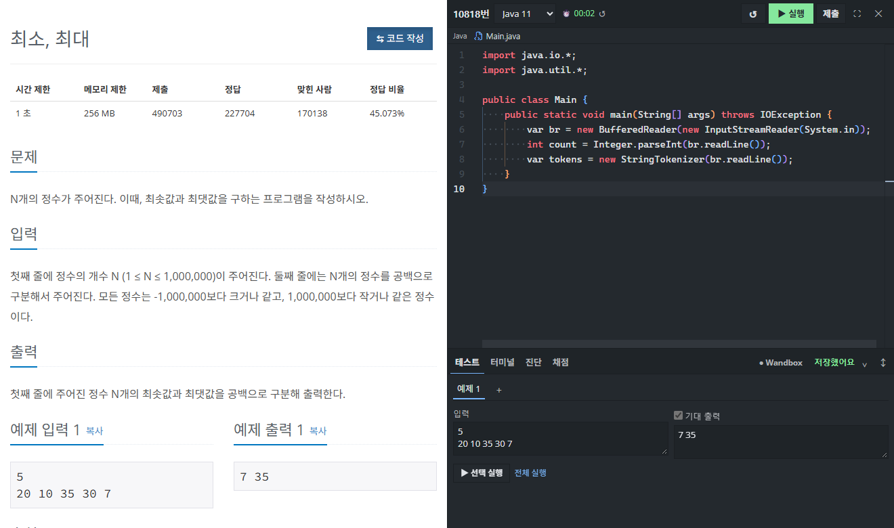
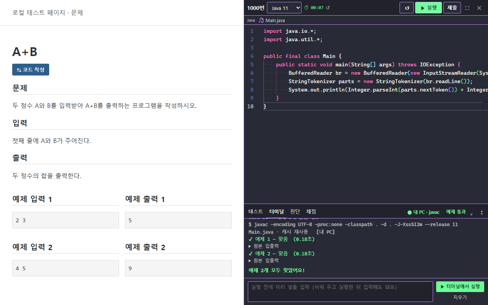
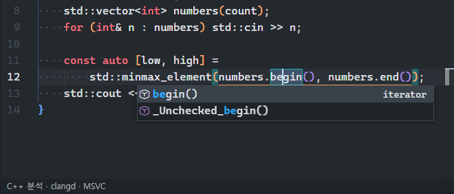
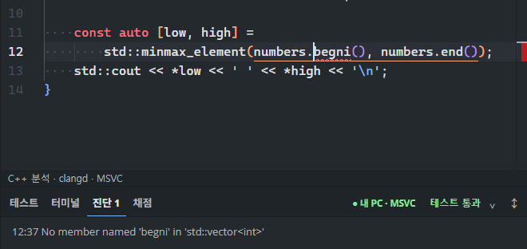
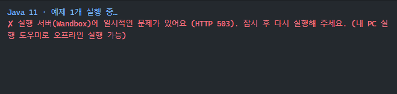
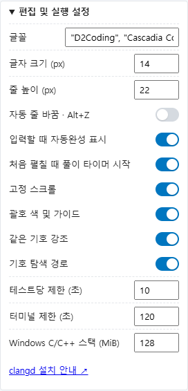
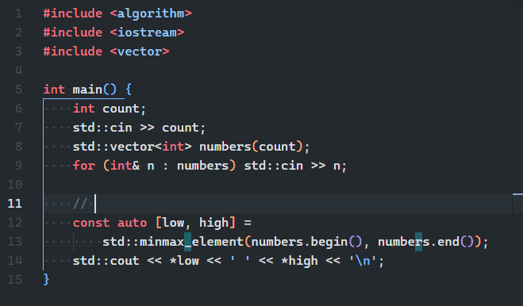

# 편한 백준 v1.5.0

백준 문제 옆에서 C·C++·Java·Python 코드를 작성하고 예제를 실행하는 Chrome 확장 프로그램입니다. 풀이 시간을 재고, 직접 제출한 뒤 같은 화면에서 채점 결과를 확인할 수 있습니다. [설치 방법](#installation)

원작은 **gaudium1257님의 Convenient BOJ**입니다. kusonnim은 원작자의 허락을 받아 이 포크를 개발했습니다. [원작 저장소](https://github.com/gaudium1257/Convenient_BOJ) · [포크 저장소](https://github.com/kusonnim/Convenient_BOJ-Workspace)

*v1.5.0에서 로그인 없이 저장한 10818번 「최소, 최대」 페이지를 열었습니다. 오른쪽에는 복원된 Java 11 초안과 풀이 타이머, 공식 예제의 입력과 기대 출력이 보입니다.* [화면 크게 보기](docs/screenshots/workspace/v1.5.0/java-stopwatch.png) · [백준 10818번](https://acmicpc.net/problem/10818)

## 원작과 이 포크의 차이

v1.5.0에서는 원작 v1.4.0의 Java 실행과 풀이 타이머를 복원하고, Java 편집과 실행을 Monaco와 Windows 도우미에 연결했습니다. [원작 v1.4.0](https://github.com/gaudium1257/Convenient_BOJ/tree/v1.4.0) · [저작자 및 라이선스 안내](NOTICE)

| 구분 | gaudium1257님의 원작에서 이어받은 기능 | 이 포크에서 추가한 기능 |
| --- | --- | --- |
| 편집 | 분할 화면, 문제·언어별 초안과 커서 복원, 기본 코드, 자동완성 켜기·끄기 | Monaco 편집기, clangd 기반 C++ 자동완성, 사용자 스니펫, 테마 8종과 입력 효과 |
| 로컬 실행 | GCC로 C·C++ 실행, JDK로 Java 실행, Python 실행, 대화형 터미널, Windows용 GCC 스택 256 MiB | x64 MSVC, MSVC·GCC 스택 크기 조절, 빌드 결과 재사용, 선택한 Java 버전에 맞춘 컴파일 |
| 테스트·온라인 실행 | 예제 추출, 문제별 사용자 테스트, 줄 단위 출력 비교, Wandbox 재시도와 동시 실행 제한 | 테스트 이름·순서 변경, 선택 실행과 취소, 원본 출력 확인, 전송 전 동의와 여러 탭에 걸친 동시 실행 제한 |
| 타이머·제출 | 문제별 풀이 타이머, 정답일 때 시간 기록, 공식 제출 페이지 채우기와 채점 결과 표시 | 탭별 제출 추적, 같은 문제를 연 탭 사이의 시간 동기화, 초안·테스트·타이머·설정 백업 |

## 설치

### Chrome에 확장 프로그램 추가하기

1. 이 포크의 소스 ZIP을 내려받아 계속 사용할 폴더에 압축을 풉니다. Git으로 복제해도 됩니다. [포크 소스 ZIP 내려받기](https://github.com/kusonnim/Convenient_BOJ-Workspace/archive/refs/heads/main.zip)
2. Chrome 주소창에 `chrome://extensions`를 입력하고 오른쪽 위 **개발자 모드**를 켭니다.
3. **압축해제된 확장 프로그램을 로드합니다**를 누르고 `manifest.json`과 `host`가 함께 들어 있는 폴더를 선택합니다. 소스 ZIP에서는 `Convenient_BOJ-Workspace-main`, 직접 설치용 `Convenient_BOJ.zip`에서는 `Convenient_BOJ`입니다.
4. 백준 문제 탭을 새로고침하고 제목 옆 **⇆ 코드 작성**을 누릅니다. Chrome은 설치 폴더에서 확장을 읽으므로 그 폴더를 같은 위치에 두세요.

Monaco와 테마는 확장에 포함되어 있어 바로 편집할 수 있습니다. Git 복제본에서 `python tools/package.py --ref HEAD --output dist`를 실행하면 ZIP 두 개가 만들어집니다. 내 PC에 직접 설치할 때는 기존 확장 ID와 도우미가 들어 있는 `Convenient_BOJ.zip`을 쓰세요. `Convenient_BOJ-webstore.zip`은 `manifest.json`이 최상위에 있고 도우미와 확장 키가 빠진 웹 스토어 제출용 파일입니다.

### 내 PC에서 실행하기 (Windows, 선택)

1. 확장 폴더에서 `host\install.bat`를 실행합니다. 도우미에는 Python 3.9 이상이 필요합니다. 설치 프로그램은 기존 도구를 먼저 찾고, 필요한 경우 Python, WinLibs(GCC), Temurin JDK 21을 설치할지 묻습니다.
2. Java에는 같은 JDK의 `javac`와 `java`가 필요합니다. C는 GCC, Python은 로컬 Python으로 실행합니다. C++17·20을 MSVC로 실행하려면 Visual Studio 또는 Build Tools의 x64 C++ 도구와 Windows SDK가 필요합니다.
3. 문제 탭을 새로고침하고 언어를 고릅니다. **터미널** 오른쪽에서 실행 위치와 컴파일러를 확인하세요. Java를 로컬에서 실행할 수 있으면 **내 PC · javac**가 표시됩니다. C++ 자동완성에는 clangd와 C++ 헤더가, C·C++ 서식 정리에는 `clang-format`이 필요합니다. [clangd 설치 안내](https://clangd.llvm.org/installation)

도우미는 현재 사용자의 `%LOCALAPPDATA%\ConvenientBOJ`에 설치되고 기본적으로 Chrome·Edge·웨일에 등록됩니다. 도구가 이미 설치되어 있고 Chrome에만 등록하려면 확장 폴더에서 PowerShell로 `.\host\install.ps1 -RegisterOnly -ChromeOnly`를 실행하세요.

**v1.5.0으로 업데이트하려면** 먼저 팝업에서 백업하세요. 백업 메뉴가 없는 버전은 중요한 초안과 설정을 따로 보관하세요. 기존 확장 폴더의 파일을 교체하고, 로컬 실행을 쓴다면 `host\install.bat`를 다시 실행해 도우미를 2.1.0으로 갱신합니다. `chrome://extensions`에서 확장을 새로고침한 뒤 열어 둔 문제 탭도 새로고침하세요. 1.3.3·1.4.0·1.4.1에서 초안과 설정이 유지되는지 검증했습니다. 도우미는 `host\uninstall.bat`로 제거합니다. [업그레이드 검증 기록](docs/development/evidence/p5/upgrades.json)

## Java로 풀기

언어 목록에서 **Java 11**처럼 사용할 버전을 고르면 Monaco가 `Main.java`를 엽니다. 새 초안은 `public class Main`과 `BufferedReader`로 시작하고, 전에 풀던 문제라면 저장한 Java 코드와 커서 위치를 복원합니다. 팝업에서 Java 기본 코드와 스니펫을 바꿀 수 있습니다. Java 자동완성은 키워드, 자주 쓰는 클래스, 문서 안의 단어와 스니펫을 제안합니다.

로컬 도우미 2.1.0은 선택한 버전에 맞춰 컴파일합니다. 설치된 JDK가 해당 버전을 지원하지 않으면 터미널에 컴파일 오류가 표시됩니다. 같은 코드의 빌드 결과는 재사용하고 입력마다 새 JVM을 시작합니다. Windows에서 JDK 27과 JetBrains JDK 21.0.10으로 실행했고, Java 11·17을 대상으로 한 컴파일을 확인했습니다. 온라인에서는 Wandbox의 OpenJDK로 실행할 수 있습니다.

*v1.5.0 로컬 검증 화면입니다. 테스트용 A+B 페이지에서 설치된 JDK로 실행했습니다. 터미널에 컴파일 대상 11, 캐시 재사용, 두 예제의 통과 결과가 보입니다.*

## 풀이 시간 재기

언어 목록 옆 **⏱**을 눌러 시작하고 다시 눌러 일시정지합니다. 시계 바로 오른쪽의 **↺**를 누르면 확인 후 이 문제의 기록을 지웁니다. 같은 문제를 연 탭들은 시간을 공유합니다. 확장이 추적하는 제출에서 **맞았습니다!!**를 받으면 타이머가 멈추고 **채점** 탭에 풀이 시간이 남습니다. [v1.5.0의 정답·타이머 화면(로컬 테스트)](docs/development/evidence/p5/accepted-timer.png)

자동 시작은 기본으로 꺼져 있습니다. 새 문제를 처음 펼칠 때부터 재려면 팝업의 **편집 및 실행 설정 → 처음 펼칠 때 풀이 타이머 시작**을 켜세요.

## 편집과 C++ IntelliSense

분할 화면의 경계를 끌거나 경계에 초점을 두고 방향키를 눌러 편집기 너비와 아래 패널 높이를 조절하세요. 경계를 두 번 클릭하면 기본 크기로 돌아갑니다. 초안과 편집 위치는 문제·언어별로 저장됩니다.

Monaco에서 `Alt`를 누른 채 클릭하면 커서를 추가하고, `Shift+Alt`를 누른 채 끌면 열 단위로 선택합니다. 코드 접기, 찾기·바꾸기, 자동 들여쓰기를 지원합니다. 팝업에서 들여쓰기를 **탭** 또는 **공백 4칸**으로 고르고, 자주 쓰는 시작 코드를 **기본 코드**에 저장하세요. `$0`은 새 초안의 첫 커서 위치입니다.

C++에서 `Ctrl+Space`를 누르면 clangd가 현재 타입과 헤더를 바탕으로 완성을 제안합니다. 함수 호출 중에는 매개변수를 확인하고, `F12`로 선언을 열 수 있습니다. 표준 라이브러리 헤더는 읽기 전용으로 열립니다. **입력할 때 자동완성 표시**를 꺼도 모든 언어에서 `Ctrl+Space`로 제안을 열 수 있습니다.

*v1.4.1에서 10818번 풀이에 `numbers.be`까지 입력했을 때의 완성 목록입니다. 아래에는 clangd가 사용하는 MSVC 헤더 환경이 표시됩니다.*

편집 중 발견한 오류는 **진단** 탭에 표시됩니다. 항목을 누르면 해당 코드로 이동합니다. 실행할 때 컴파일러가 낸 오류는 **터미널**에서 확인할 수 있고, 같은 버전의 초안이면 오류 위치를 눌러 이동할 수 있습니다.

*v1.4.1에서 `begin`을 `begni`로 잘못 입력하자 다시 실행하기 전에 clangd가 12행의 오타를 표시했습니다.*

## 테스트와 터미널

**테스트** 탭에는 문제의 예제가 원래 순서대로 표시됩니다. **+**를 눌러 문제별 테스트를 추가하고 이름, 입력, 기대 출력을 적으세요. 직접 만든 탭은 끌거나 탭에 초점을 둔 채 `Alt+←` 또는 `Alt+→`를 눌러 순서를 바꿀 수 있습니다.

*v1.4.1에서 만든 「음수만 있는 경우」 테스트입니다. **전체에 포함**을 켜고 MSVC로 실행해 공식 예제와 이 테스트가 모두 통과했습니다.* [v1.4.1의 전체 실행 화면](docs/screenshots/workspace/workspace.png)

- **기대 출력**을 끄면 결과만 봅니다. 켜고 비워 두면 출력이 비어 있는지도 검사합니다. 비교할 때는 줄바꿈 방식, 줄 끝의 공백·탭, 마지막 빈 줄을 무시합니다. 결과가 다르면 처음 다른 줄을 보여 줍니다. **원본 입출력**에서 입력과 기대 출력, 표준 출력(`stdout`)과 표준 오류(`stderr`)를 확인할 수 있습니다.
- **실행 환경**을 자동으로 두면 C++17·20은 사용 가능한 x64 MSVC를 우선하고, 다른 표준에는 가능한 경우 GCC를 씁니다. 로컬 컴파일러와 백준 제출 언어는 따로 선택합니다. 같은 탭에서 소스·설정·헤더가 같으면 빌드 결과를 재사용합니다.
- **Windows C/C++ 스택 (MiB)**에서 로컬 실행 파일의 스택 예약 크기를 1~512 MiB로 조절합니다. 기본값은 256 MiB입니다. 도우미 2.1.0은 MSVC의 C++와 GCC의 C·C++에 이 값을 적용하고, 값을 바꾸면 다음 실행에서 다시 빌드합니다. Java 스레드의 스택은 별도로 512 MiB입니다.
- **터미널에서 실행**을 누르면 프로그램에 직접 입력할 수 있습니다. `Enter`로 입력을 보내고 `Ctrl+D`로 입력을 끝내며 `Ctrl+C`로 중지합니다. C++ 출력이 버퍼에 남아 있다면 `std::flush`나 `std::endl`로 비우세요. Wandbox에서는 실행 전에 입력을 한꺼번에 전달합니다.

### Wandbox로 온라인 실행하기

팝업에서 **Wandbox · 코드와 입력 전송**을 선택하거나 해당 실행의 전송 안내에 동의하면 소스와 입력이 Wandbox로 전송됩니다. 여러 탭을 합쳐 동시에 최대 3건을 실행합니다. 중지하거나 문제 탭을 닫으면 대기 중이거나 실행 중인 요청도 취소됩니다.

연결이 끊기거나 서버가 HTTP 429·500·502·503·504를 반환하면 0.8초, 1.6초 간격으로 최대 두 번 더 시도합니다. 개별 요청의 제한 시간은 40초입니다. 서버가 `Retry-After`로 더 긴 대기를 요청하면 10초까지 따르고, 10초를 넘으면 오류를 표시합니다. 컴파일 오류는 터미널에서 확인하세요.

*v1.5.0에서 모의 서버가 세 번 모두 HTTP 503을 반환한 뒤 표시한 안내입니다. 실제 Wandbox로 코드를 보내지 않고 촬영했습니다.*

## 제출과 채점

1. 편집기 위의 **제출**을 누르면 옆 탭에 백준 공식 제출 페이지가 열리고 초안이 채워집니다. Java를 포함한 제출 언어는 번호와 이름으로 찾습니다. 번호가 바뀌면 이름이 일치하는 항목이 하나일 때만 선택합니다. 언어를 찾지 못하면 공식 페이지에서 직접 고르세요. 코드 공개 범위의 기본값은 백준 설정을 따릅니다.
2. 코드와 언어를 확인하고 보안 확인(reCAPTCHA)이 표시되면 직접 완료하세요. **공식 페이지의 제출 버튼은 사용자가 직접 누릅니다.**
3. 제출하면 원래 문제 탭으로 돌아옵니다. **채점**에서 결과와 메모리, 실행 시간, 코드 보기 링크를 확인하세요. 채점이 끝나면 확장이 연 제출 탭은 닫힙니다. 탭을 일찍 닫았거나 같은 문제의 여러 제출을 구분하기 어려우면 **제출 기록 열기**를 이용하세요.

## 설정과 백업

*v1.5.0에서 자동 시작을 켜고 스택을 128 MiB로 바꿨습니다. 팝업을 새로고친 뒤에도 두 값이 유지됩니다.* [v1.4.1의 실행 환경·테마 설정 화면](docs/screenshots/workspace/settings.png)

- **편집 및 실행 설정**에서 글자 크기, 줄 높이, 자동 줄 바꿈, 고정 스크롤, 괄호 안내선, 같은 기호 강조와 실행 시간 제한을 조절합니다. 편집기 위의 **기호 탐색 경로**를 누르면 함수나 클래스 목록에서 이동할 곳을 고를 수 있습니다.
- **사용자 스니펫**에 언어별 접두어와 본문을 저장하세요. 편집기에서 접두어를 입력하고 `Ctrl+Space`로 스니펫을 고릅니다. `Tab`을 누르면 `${1:값}`처럼 표시한 입력 위치를 차례로 거쳐 `$0`으로 이동합니다.
- **초안·테스트·설정 백업**은 Java를 포함한 언어별 초안·커서 위치·기본 코드·스니펫, 문제별 테스트와 풀이 시간, 편집·실행 설정을 평문 JSON에 저장합니다. 계정 정보와 제출·채점 세션은 제외됩니다. 복원 기본값은 **기존 값 유지**입니다. **충돌 값 교체**에는 확인이 필요하고 열린 초안은 보호됩니다. Wandbox 실행 설정을 복원할 때도 전송에 다시 동의해야 합니다. 백업에는 코드가 들어 있으니 비공개로 보관하세요.

**Power Mode**는 기본으로 꺼져 있습니다. 켜면 Spark·Aurora·Pixel 중에서 입력 효과를 고르고 입자 강도와 화면 흔들림을 조절할 수 있습니다. 시스템의 동작 줄이기 설정을 켜면 입력 효과도 꺼집니다.

Power Mode 입력 효과 보기

*v1.4.1에서 10818번 초안에 주석을 입력하며 촬영한 Aurora 효과입니다.*

## 단축키

팝업의 **단축키**에서 **기존** 또는 **테스트 중심**을 고를 수 있습니다.

| 동작 | 기존 (기본값) | 테스트 중심 |
| --- | --- | --- |
| 선택한 테스트 실행 | `Ctrl+Alt+Enter` | `Ctrl+Enter` 또는 `Ctrl+Alt+Enter` |
| 전체 테스트 실행 | `Ctrl+Enter` | `Ctrl+Shift+Enter` |
| 공식 제출 페이지 열기 | `Ctrl+Shift+Enter` | `Ctrl+Shift+S` |

| 공통 단축키 | 동작 |
| --- | --- |
| `Alt+C` / `Ctrl+S` | 분할 화면 열기·닫기 / 초안 저장 |
| `Ctrl+Shift+X` | 실행 중지 |
| `Ctrl+Space` / `F12` | 자동완성 열기 / C++ 선언으로 이동 |
| `Ctrl+F` / `Ctrl+H` | 찾기 / 바꾸기 |
| `Alt+Z` / `Shift+Alt+F` | 자동 줄 바꿈 전환 / C·C++ 서식 정리 (`Ctrl+Z`로 되돌리기) |
| `Alt+↑`·`Alt+↓` / `Shift+Alt+↑`·`Shift+Alt+↓` | 줄 이동 / 줄 복제 |

## 알려진 제한 사항

- 도우미는 현재 Windows 사용자의 권한으로 코드를 실행합니다. MSVC로 시작하는 새 C++ 초안은 `<iostream>`을 사용합니다. GNU 전용 `bits/stdc++.h`나 `__int128`이 필요한 코드는 GCC로 실행하세요. 로컬 실행 시간과 스페셜 저지 문제의 예제 비교 결과는 참고용입니다.
- 초안·사용자 테스트·스니펫은 Chrome 프로필의 로컬 저장소에 있습니다. 테마와 기본 코드 등은 Chrome 동기화 설정을 따릅니다. 확장 ID를 고정한 1.3.0보다 오래된 버전에서 옮길 때는 초안과 설정을 먼저 따로 보관하세요.
- v1.5.0은 Windows용 Chrome에서 검증했습니다. 다른 운영체제와 Edge·웨일, 새 PC에서의 Temurin 자동 설치는 확인 전입니다. Wandbox 실행은 모의 서버로, 제출·채점·상태 조회는 로컬 테스트 페이지로 검증했습니다. 실제 계정의 제출과 외부 Git 연동은 검증 범위 밖입니다. 백준에는 직접 작성한 풀이만 직접 제출하세요. 자동 제출과 AI가 작성한 풀이 제출은 금지합니다. [백준 계정 보호 원칙](PROJECT_SPEC.md#mandatory-boj-account-safety)

## 성능 측정

v1.5.0을 설치한 Windows Chrome 158에서 새 프로필 3개에 같은 400줄 C++ 초안을 열었습니다. 편집할 수 있을 때까지 걸린 시간의 중앙값은 처음 열 때 **431밀리초**, 다시 열 때 **97밀리초**였습니다. 별도 표준 라이브러리 예제에서 clangd의 첫 자동완성은 **3.105초**, 이후 다섯 번의 중앙값은 **120밀리초**였습니다. [편집기 측정값](docs/development/evidence/p5/editor-performance.json) · [자동완성 측정값](docs/development/evidence/p5/latency.json)

## 프로젝트 구조와 개발 문서

| 위치 | 내용 |
| --- | --- |
| `manifest.json`, `background.js` | 확장 설정, 실행 요청과 제출 탭 관리 |
| `content/`, `shared/` | 분할 화면, 백준 페이지 연동, 공통 설정과 저장 형식 |
| `editor/`, `popup/` | Monaco 편집 화면과 설정 팝업 |
| `host/` | Windows 실행·분석 도우미와 설치·제거 스크립트 |
| `vendor/`, `tools/monaco/` | 확장에 포함된 편집기·테마·라이선스와 빌드 도구 |
| `docs/screenshots/`, `docs/development/` | 사용 화면, 단계별 검증 기록과 측정 자료 |

v1.5.0 검증에서 Chrome 테스트 53개와 도우미 테스트 35개가 통과했습니다. 개발 문서와 촬영 기록은 영어로 제공합니다. [프로젝트 명세](PROJECT_SPEC.md) · [로드맵](ROADMAP.md) · [v1.5.0 검증 보고서](docs/development/P5.md) · [원작 변경 사항 반영 절차](docs/development/upstream-sync.md) · [화면 촬영·검증 기록](docs/development/README-localization.md)
